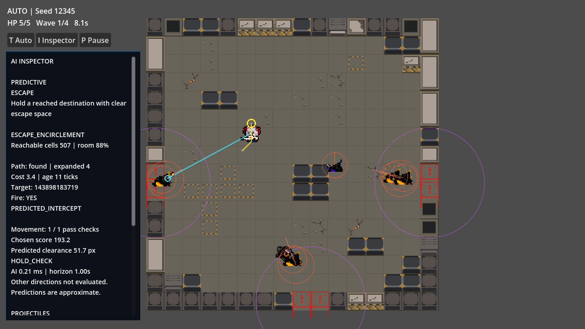

# Godot 2D Shooting Game

A top-down survival shooter with an autonomous player whose decisions can be inspected while the game runs. The Auto player routes around obstacles, predicts contact with moving enemies, aims and fires, collects useful drops, and retreats when it needs room to escape.

- **Project date:** September 2026
- **Languages:** GDScript and C++17
- **Engine:** Godot 4.7.2 standard
- **Validated game platform:** Windows x64



## Project background and my contribution

This was my first Godot project. I built the entire original shooting demo step by step by following [Voidmatrix's Bilibili video guide](https://www.bilibili.com/video/BV1UQRwBoEiy). The textures and sprites were supplied with that guide.

**Auto player mode and survival waves are my own designs**, added beyond the tutorial. I defined their behaviour, directed implementation, reviewed gameplay and used failures such as spawn-camping and corner traps to guide improvements. The engineering extensions include modular weapons and buffs, a native C++ pathfinding library, projectile pooling and automated verification.

I used **OpenAI Codex as a productivity tool** for coding, debugging, testing and documentation. I directed the work and evaluated changes through gameplay and validation results, retaining responsibility for design decisions and the final outcome.

## Gameplay

Survive four waves in a compact arena. Enemies pursue the player, and bombers explode when killed. Dropped items provide temporary speed, rapid-fire or spiral-shot effects. Switch between manual play and Auto at any time during a run; both modes use the same movement, health, collisions and weapon cooldowns.

The inspector shows the controller's actual objective, target, route, predicted clearance, fire decision and rejection reasons. It also draws the route, intercept line, hazards and known spawn exclusion zones. Pause and single-step to examine how a decision changes the next physics tick.

## Build and run

The native extension must be built **before the first Godot import**. Source control excludes generated DLLs and import caches.

### Requirements

- Godot **4.7.2 standard**; the .NET edition is not required.
- A C++17 compiler. On Windows, use Visual Studio with **Desktop development with C++** and a Windows SDK.
- **CMake 3.24+**, **Python 3** and PowerShell. The examples assume their commands are on `PATH`.
- Internet access for the first build to download the pinned official `godot-cpp` bindings.

From the repository root:

```powershell
./scripts/build_native.ps1 -CMake cmake -Python python
godot --editor --path .
```

Open `project.godot` and press **F5** to play. To start directly in Auto mode:

```powershell
godot --path . -- --auto --seed=12345
```

The build verifies the bindings archive with SHA-256 and creates separate debug-runtime and release-runtime libraries in `bin/`. These target Godot's 4.5 extension API and have been tested with Godot 4.7.2. Close Godot before rebuilding a loaded DLL; extension hot reload is disabled. Only the Windows game/adapter build has been validated locally.

If tools are elsewhere, pass executable paths using `-CMake`, `-Python` and `-Godot` in the relevant scripts. No editor AI addon or external AI service is required to play or test the game.

## Controls

Click inside the game window before using the keyboard.

| Key or input | Action |
| --- | --- |
| WASD | Move |
| Mouse / arrow keys | Aim; arrow keys take priority |
| Left click / Space | Fire; the spiral effect fires automatically |
| T | Switch manual / Auto control |
| I | Show or hide the AI inspector and drawings |
| C | Cycle basic, A* route-only and predictive planners |
| P | Pause or resume |
| N | Advance one physics tick while paused |
| R | Restart with the same seed, control mode and planner |
| Y | Restart with the next seed |

Gameplay commands use unmodified keys configured in Godot's Input Map. Function keys remain available to the editor, including **F8 to stop**. Escape remains available for modal UI.

Launch arguments after `--` include `--auto`, `--baseline`, `--route-only`, `--seed=12345` and `--unpooled`.

## Engineering design

### Shared intent and modular combat

`HumanController` and `AutoController` return a `ControlFrame` containing movement, aim and a fire request. `Player` applies the common game rules. `WeaponController` owns firing cadence and delegates shot geometry to interchangeable `WeaponShotPattern` implementations. `BuffController` keeps independently refreshable, expiring effects and derives current movement and firing stats. Weighted drop selection uses configured probabilities.

### Native A* and data structures

The independent C++ core implements a stable binary min-heap and A* over contiguous grid arrays. Manhattan or octile heuristics, nonnegative risk costs, diagonal corner checks and an expansion budget define the search contract. Results distinguish success, unreachable goals, invalid input and budget exhaustion. A thin GDExtension handles engine conversion and registration.

The code demonstrates value types, coordinate equality operators, const references, RAII containers and Godot registration macros. Native tests compare weighted route costs with an independently implemented Dijkstra oracle on 100 grids.

### Tactical Auto control

Goal selection combines firing distance, useful pickups, expiry and available escape space. A bounded flood fill identifies connected destinations through terrain and observed enemy barriers. Native A* plans the route; local steering forecasts relative motion, sweeps for walls and checks arrival followed by stopping.

Retreat takes priority over loot when the player is confined, surrounded or in a known spawn lane. If enemies block an escape corridor, targeting can prioritize a vulnerable blocker. Intercept aiming leads moving enemies and checks the firing corridor; nearby bomber kills are delayed to gain explosion clearance. Short evasion commitments reduce reversals while fresh safety checks can cancel them.

### Projectile lifecycle

The pool and an instantiate/free reference backend share the same firing contract. Pool acquisition uses an O(1) free-object stack with prewarming and a capacity cap. Recycling is deferred past physics callbacks; activation identifiers prevent stale callbacks from affecting a reused bullet. Acquisition misses are counted rather than silently hiding dropped shots.

## Project structure

```text
project.godot            Godot project and input configuration
scene/                  Arena, actors, gameplay scripts and shader
resources/              Referenced textures, audio, font and configuration
scripts/
  ai/                   Perception, goals, routing, steering, aiming, inspector
  combat/               Weapons, buffs, shot patterns and projectile backends
  control/              Shared intent, human input and shortcuts
  math/                 Weighted sampling
  *.ps1, *.py            Native build, tests and Windows export tools
native/                 Independent C++ core, adapter, CMake and native tests
bin/                    GDExtension descriptor; compiled libraries are generated
tests/                  Game regressions and reproducible benchmarks
.github/workflows/      Build, regression and Windows export verification
docs/images/            README gameplay screenshot
licenses/               Required engine notice
```

## Verification

Run the game regressions after building the native libraries:

```powershell
./scripts/test_game.ps1 -Godot godot
```

The wrapper imports the project, creates an isolated runtime fixture and checks engine diagnostics as well as assertions. Close the editor for the default import step. If this same project is already fully imported and open, use `-SkipImport` to avoid a second import competing for the DLL.

The native core can be built and tested independently, without Godot, Python or a bindings download:

```powershell
cmake -S native -B build/core -DBUILD_GODOT_EXTENSION=OFF
cmake --build build/core --config Release
ctest --test-dir build/core -C Release --output-on-failure --no-tests=error
```

Regressions cover weapon extensibility, buff expiry, weighted sampling, projectile reuse/exhaustion, native integration, input conflicts, pause/single-step, intercept aiming and tactical escape. The current recorded suite passes **38 Godot tests / 509 checks** and **710 native checks per runtime build**.

GitHub Actions is configured to test the standalone core on Windows and Linux and to build, test and export the game on Windows. A remote CI pass is not claimed before this repository is uploaded and the workflow runs.

## Benchmarks and known limits

```powershell
$fixture = ./scripts/prepare_validation.ps1
godot --headless --path $fixture --fixed-fps 60 --script res://tests/benchmark_autoplay.gd -- --predictive --seeds=12345,54321,999 --repeats=2 --profile-ai
godot --headless --path $fixture --fixed-fps 60 --script res://tests/benchmark_tactics.gd
godot --headless --path $fixture --fixed-fps 60 --script res://tests/benchmark_pool.gd
```

Generated JSON stays under the fixture's ignored `benchmark-results/`. `benchmark_ai_kernels.gd` checks fixed-input algorithm work; `benchmark_rendered.gd` requires rendering enabled instead of `--headless`.

Recorded local evaluation on **13 November 2026**, using Windows x64 and an Intel i7-10750H:

| Movement policy | Full-game clears | Mean damage | Median per-run AI p95 |
| --- | --- | --- | --- |
| Basic approach and retreat | 13/20 | 2.70 | 0.465 ms |
| A* route-only | 20/20 | 0.80 | 0.813 ms |
| Predictive route and steering | 20/20 | 0.15 | 2.648 ms |

A second predictive session also cleared 20/20: **40 runs across 20 distinct seeds**. Route-only collected more items and used less CPU. Fixed seeds aid comparison but do not guarantee bit-identical Godot physics.

In repeated before/after profiling, mean per-run AI p95 fell from **3.604 to 2.635 ms**. The original 2 ms target remains unmet. Controlled spawn-drop and corner-pincer fixtures improved from one damage point to zero, while an already closed enemy ring still caused a hit. Enemy motion forecasts are approximate and navigation is tuned to the current fixed arena. Headless timings measure CPU work, not GPU frame rate or a guarantee of human-level play.

## Windows export

Build both native runtime variants first. With `godot` on `PATH`:

```powershell
python ./scripts/fetch_windows_template.py
$fixture = ./scripts/prepare_validation.ps1
./scripts/build_demo.ps1 -Godot (Get-Command godot).Source -Source $fixture -WindowsTemplate .godot/windows-templates/windows_release_x86_64.exe
```

The helper downloads the pinned official release template, exports from the isolated fixture and runs the packaged game's runtime check. Generated executables, archives and logs remain under ignored output directories.

## Credits and asset terms

- Tutorial foundation: [Voidmatrix's Godot 2D shooter guide](https://www.bilibili.com/video/BV1UQRwBoEiy).
- Textures and sprites: supplied with the guide. Existing audio and font assets are retained from the practice project; full upstream attribution and redistribution terms have not been verified.
- Auto player mode and survival waves: my original designs, developed with the directed AI assistance described above.
- Native bindings: official `godot-cpp`, pinned by commit and archive checksum.

See [THIRD_PARTY_NOTICES.md](THIRD_PARTY_NOTICES.md) for notices. This repository does not grant a new license to the tutorial's assets or claim them as original artwork.
